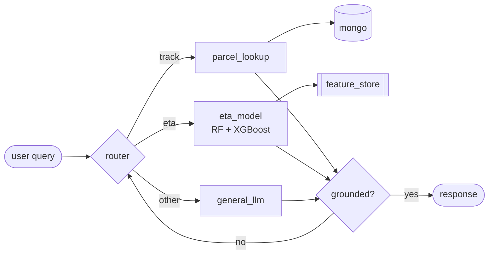

<h1 align="center">Nivakaran Shanmugabavan</h1>

  <b>I build software that thinks.</b> 
  Software engineer and AI builder in Colombo, Sri Lanka.

  <a href="https://nivakaran.dev">Portfolio</a> &nbsp;·&nbsp;
  <a href="https://linkedin.com/in/nivakaran">LinkedIn</a> &nbsp;·&nbsp;
  <a href="mailto:nivakaran@hotmail.com">Email</a>

 

I started on the receiving end of other people's software: a bank's contact centre, a medical scribe desk, a claims-collections queue. Most problems there weren't technical. They were problems of attention, and bad tools spent it. I became an engineer to fix that, and I try to ship things people can actually use.

## Now

- **Associate Software Engineer** at Healplace, building healthcare software.
- **MedVerse**, a clinical monitoring platform I build with Team ADAGARD, selected into the NIBM Neo Ventures incubator.
- **B.Sc. in Information Technology** at SLIIT, graduating in 2027.

## Selected work

### MedVerse

**Continuous monitoring for hospital wards.**

Wards are reactive: vitals are spot-checked every few hours, so a patient can deteriorate between checks. MedVerse takes a reading from a wearable sensor at the bedside to the dashboard a clinician reads. The models are research artifacts trained on public datasets, not clinically validated, and the build fails if an unvalidated model is ever shown as trustworthy.

ESP32-S3 firmware with on-device signal processing, about 8 models, FastAPI with TimescaleDB and MQTT, a LangGraph agent layer, a React dashboard and a Flutter app.

[Read about MedVerse](https://nivakaran.dev/medverse)

### Sparrow

**Delivery estimates you can plan around.**

Sparrow learns from thousands of past deliveries to predict when a parcel will actually arrive, and an AI agent answers tracking questions on its own, with no human in the loop.

Random Forest and XGBoost for ETA prediction, a LangGraph agent on Groq, Node.js services.

[Read about Sparrow](https://nivakaran.dev/work/sparrow) &nbsp;·&nbsp; [Source](https://github.com/Nivakaran-S/Sparrow-Agent)

### EcoHarvest

**Surplus food finds a buyer before it finds a bin.**

A marketplace where suppliers list surplus food and buyers claim it cheaply. It includes an AI assistant for customer questions and a model that recognises food from a photo.

Next.js, Node.js, MongoDB, and EfficientNet-B0 fine-tuned on Food-101.

[See EcoHarvest live](https://eco-harvest-frontend.vercel.app) &nbsp;·&nbsp; [Source](https://github.com/Nivakaran-S/EcoHarvest)

### Book Recommender

**Describe a feeling, get a book.**

Search engines need you to know the answer first. This one matches what a book is about, not the words in its title, so "homesick" or "something gentle" works.

Sentence embeddings, cosine similarity, Flask.

[Try the Book Recommender](https://nivakaran-book-recommendation.hf.space) &nbsp;·&nbsp; [Source](https://github.com/Nivakaran-S/Book-Recommendation)

### Cat / Dog / Person Classifier

**A neural network built from scratch, to understand it.**

I wrote the convolutional network myself instead of downloading a trained one, because I wanted to know why these models see what they see.

PyTorch and Gradio.

[Try the classifier](https://nivakaran-classification-gradio-kncvu.hf.space/?__theme=system) &nbsp;·&nbsp; [Source](https://github.com/Nivakaran-S/Cat-Dog-Person-Classifier)

## Experience

| When | Role | Where |
|------|------|-------|
| Mar 2026 – now | Junior Full Stack Developer, promoted to Associate Software Engineer in Sep 2026 | Healplace LLC |
| Jan 2026 – Jul 2026 | Operations Analyst (Associate, Collections) | HealthRecon Connect |
| Aug 2025 – Dec 2025 | Process Associate (real estate research) | Intelligent Image Management Inc. |
| Jul 2022 – Dec 2024 | Medical Scribe and Medical Billing, Documentation Specialist | Medsource Healthcare LLC |
| Feb 2022 – Jun 2022 | Customer Service Executive | Startek, Commercial Bank PLC |

<b>How I got here</b>

 

**In a bank's contact centre**, I learned that when someone is frustrated, they don't want a clever answer; they want to be understood first.

**As a medical scribe**, I documented doctors' appointments as they happened, working remotely with US cardiologists and other specialists. While the doctor examined a patient and talked through what they were finding, I wrote it down in real time: the symptoms, the diagnosis, the plan. I also did the medical billing for those visits: assigning the appropriate CPT codes and keeping the EHR complete, from appointment notes to lab results and other medical reports.

**As a process associate on a real estate research team**, I researched US properties and wrote up what an insurer would need to know: what a property covers, what threats it faces, and the detail that sets a baseline for judging the risk.

**As an operations analyst in collections**, I worked through the unglamorous end of medical billing. I took claims from spreadsheets, researched why each one had been denied, then called the insurance companies and made the fix needed to collect the pending amount.

> A doctor has fifteen minutes with a patient. An analyst has a thousand rows and an afternoon. Every minute lost wrestling with a clumsy tool is a minute not spent on the thing that actually mattered.

In March 2026 I joined **Healplace** as a Junior Full Stack Developer, building software for the same healthcare world I used to work inside. By September I was promoted to **Associate Software Engineer**. Whenever I build something, I ask the same question I asked in those jobs: *who is on the other end of this, and what do they actually need from me?*

## What I work with

| | |
|---|---|
| **Machine learning** | Models that recognise images, understand language, and make predictions. |
| **Agents** | AI that looks things up, uses tools, and completes tasks. |
| **Web and mobile** | The part people see and touch, front to back. |
| **Data** | Moving and processing large amounts of information reliably. |

<b>Full toolkit, certifications, and Sparrow's agent design</b>

 

Python, TypeScript, JavaScript, Java, Kotlin. PyTorch, TensorFlow, scikit-learn, Hugging Face. LangChain, LangGraph, Groq. FastAPI, Flask, Node.js, Next.js, React, Flutter. MongoDB, PostgreSQL, Kafka, Airflow, MLflow. Docker, AWS, GCP, Azure.

**Sparrow's agent design**, showing how a tracking query gets resolved:

**Certifications**

| Year | Certification |
|------|---------------|
| 2025 | Big Data Engineering Bootcamp: GCP & Azure |
| 2025 | Agentic AI Bootcamp: LangGraph & LangChain |
| 2025 | Advanced ML, NLP & Deep Learning Bootcamp |
| 2025 | Computer Vision Bootcamp: PyTorch & TensorFlow |
| 2025 | Complete Node.js Developer: GraphQL & MongoDB |
| 2025 | Complete Machine Learning & Data Science Bootcamp |
| 2024 | Complete Generative AI: LangChain & Hugging Face |
| 2024 | TensorFlow for Deep Learning |

## Open to

Applied AI teams building things that reach real users, open source projects in machine learning and agents, and hackathons. Remote work anywhere.

## Recently

<!-- ACTIVITY:START -->
- 14 Oct 2026, pushed 4 commits to **J26-SE-325**
- 13 Oct 2026, pushed 2 commits to **J26-SE-325**
- 12 Oct 2026, pushed 5 commits to **portfolio-latest**
- 04 Oct 2026, pushed 13 commits to **Adagard_Lodestar**
- 03 Oct 2026, pushed 14 commits to **Adagard_Lodestar**
- 02 Oct 2026, pushed 19 commits to **Adagard_Lodestar**
- 27 Sep 2026, pushed 7 commits to **SSD-Assignment**
- 27 Sep 2026, merged pull request #13 in **SSD-Assignment**

Updated 15 Oct 2026, 06:03 (Asia/Colombo).
<!-- ACTIVITY:END -->

## Say hello

I reply to everything, usually within a day. [nivakaran@hotmail.com](mailto:nivakaran@hotmail.com) &nbsp;·&nbsp; [LinkedIn](https://linkedin.com/in/nivakaran) &nbsp;·&nbsp; [nivakaran.dev](https://nivakaran.dev)

The Recently list is rewritten every six hours by a GitHub Action in this repository.
